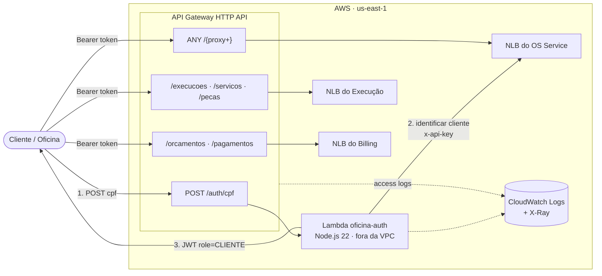
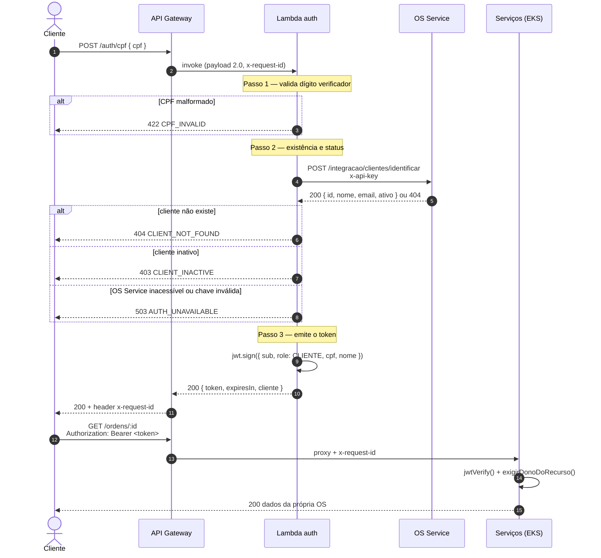

# oficina-auth-lambda

**Function serverless de autenticação por CPF** e **API Gateway** da Oficina Mecânica.
Tech Challenge — Fase 4.

Este repositório entrega os dois componentes que ficam na frente de toda a plataforma:

- a função que autentica o cliente final pelo CPF e emite o JWT;
- o gateway, ponto único de entrada, que roteia `/auth/cpf` para a função e cada prefixo para o microsserviço dono dele.

> **Fase 4:** a função não lê mais o banco. Ela pergunta ao OS Service
> (`POST /integracao/clientes/identificar`, com chave de integração), que é o dono dos
> clientes, e saiu da VPC: não precisa mais alcançar o RDS
> ([ADR-0013](https://github.com/Xikin/tech_challenge/blob/main/docs/adr/0013-divisao-em-tres-microsservicos.md)).

| Repositório | Papel |
| --- | --- |
| **oficina-auth-lambda** (este) | Autenticação por CPF + API Gateway |
| [oficina-mvp](https://github.com/Xikin/tech_challenge) | OS Service — clientes, veículos, OS, orquestração da saga |
| [oficina-execucao](https://github.com/Xikin/oficina-execucao) | Execução e Produção |
| [oficina-billing](https://github.com/Xikin/oficina-billing) | Orçamento e Pagamento |
| [oficina-infra-k8s](https://github.com/Xikin/oficina-infra-k8s) | VPC, EKS, ECR, RabbitMQ |
| [oficina-infra-db](https://github.com/Xikin/oficina-infra-db) | RDS do OS Service e do Execução |

---

## Arquitetura desta stack



| Rota no gateway | Destino |
| --- | --- |
| `POST /auth/cpf` | Esta Lambda |
| `/execucoes`, `/servicos`, `/pecas` (e subcaminhos) | Execução e Produção |
| `/orcamentos`, `/pagamentos` (e subcaminhos) | Orçamento e Pagamento; o webhook do Mercado Pago chega em `/pagamentos/webhook` |
| todo o resto | OS Service |

O endereço de cada serviço vem do SSM (`/oficina/<env>/<servico>/endpoint`), publicado pelo pipeline do serviço. A URL do gateway é publicada em `/oficina/<env>/gateway/url`, de onde o Billing tira o endereço do webhook.

### Fluxo de autenticação — diagrama de sequência



### Decisões que valem explicar

**HTTP em vez de banco.** Na Fase 3 a função lia `clientes` direto do RDS. Na Fase 4
nenhum serviço pode acessar o banco de outro, então ela pergunta ao OS Service. A chamada
tem timeout de 3 s, repassa o `x-request-id` e usa a chave `INTEGRACAO_API_KEY`, gerada
pelo pipeline do OS Service no SSM. Sem banco, o bundle caiu de 315 KB para 28 KB e a
função saiu da VPC. A VPC não tem NAT, então dentro dela a função não alcançaria o
Load Balancer.

**404 e 403 são respostas diferentes.** O requisito pede "consultar a existência **e
o status**" — cliente inexistente devolve 404, cliente inativo devolve 403. Colapsar
os dois num só código perderia a distinção que o enunciado pede.

**Só CPF, sem CNPJ.** O validador da API aceita CPF ou CNPJ; aqui o ramo de CNPJ foi
deliberadamente removido, e o OS Service só identifica clientes `FISICA`. Autenticação
de pessoa física não deve aceitar documento de pessoa jurídica.

**CPF nunca aparece em log.** `mascararCPF` reduz para `***.***.247-25` antes de
qualquer linha de log, e o corpo da resposta devolve apenas `id` e `nome` do cliente.

**Segredo próprio, não o da API.** A função assina com `JWT_CLIENTE_SECRET`, diferente do
`JWT_SECRET` do login interno, e a API só aceita deste emissor tokens com `role: CLIENTE`.
Quem obtiver a configuração desta função consegue, no máximo, se passar por um cliente —
nunca por um administrador ([ADR-0011](https://github.com/Xikin/tech_challenge/blob/main/docs/adr/0011-segredos-jwt-por-emissor.md)).

**Concorrência reservada.** A função tem teto de 10 execuções simultâneas
(`lambda_reserved_concurrency`). Sem ele, uma força bruta de CPF escalaria até o limite da
conta e despejaria a carga no OS Service.

**Segredos por variável de ambiente.** Ver
[ADR-0006](docs/adr/0006-segredos-da-lambda.md). A chave de integração e o endereço do
OS Service são lidos do SSM pelo Terraform no deploy, não em runtime.

---

## Tecnologias

| Camada | Tecnologia |
| --- | --- |
| Runtime | Node.js 22 (ESM), TypeScript |
| Bundle | esbuild — artefato único de ~28 KB |
| Clientes | HTTP para o OS Service (`fetch` nativo) |
| Token | `jsonwebtoken` (HS256), compatível com `@fastify/jwt` da API |
| Gateway | AWS API Gateway **HTTP API** (v2) |
| IaC | Terraform ~> 1.10, backend S3 |
| Testes | Vitest — 43 testes, 99,7% de cobertura (mínimo 80%) |
| Observabilidade | Logs JSON + AWS X-Ray + access logs do gateway |

---

## Contrato da API

### `POST /auth/cpf`

```jsonc
// requisição
{ "cpf": "529.982.247-25" }   // aceita com ou sem máscara
```

```jsonc
// 200 OK
{
  "token": "eyJhbGciOiJIUzI1NiIs...",
  "expiresIn": "8h",
  "cliente": { "id": "uuid", "nome": "Ana Souza" }
}
```

| Status | `code` | Quando |
| --- | --- | --- |
| 200 | — | CPF válido, cliente existe e está ativo |
| 400 | `INVALID_BODY` | corpo não é JSON |
| 400 | `CPF_REQUIRED` | campo `cpf` ausente ou vazio |
| 422 | `CPF_INVALID` | dígito verificador não confere |
| 404 | `CLIENT_NOT_FOUND` | CPF válido, mas sem cadastro |
| 403 | `CLIENT_INACTIVE` | cliente existe, porém inativo |
| 500 | `MISCONFIGURED` | `JWT_CLIENTE_SECRET` ausente na função |
| 503 | `AUTH_UNAVAILABLE` | OS Service inacessível, timeout ou chave de integração inválida |

Toda resposta — inclusive as de erro — devolve o header `x-request-id` para
correlação com os logs.

### Payload do JWT

```jsonc
{
  "sub": "uuid-do-cliente",
  "role": "CLIENTE",
  "cpf": "52998224725",
  "nome": "Ana Souza",
  "email": "ana@example.com",   // omitido quando o cliente não tem e-mail
  "iss": "oficina-auth-lambda",
  "iat": 1757462400,
  "exp": 1757491200
}
```

### Swagger / Postman

Cada microsserviço publica o próprio OpenAPI (`docs/openapi.json`) e coleção Postman (`postman/`):
[OS Service](https://github.com/Xikin/tech_challenge), [Execução](https://github.com/Xikin/oficina-execucao)
e [Billing](https://github.com/Xikin/oficina-billing). Swagger do OS Service: `<API_GATEWAY_URL>/docs`.

---

## Execução local

```bash
npm ci
npm test          # 43 testes, sem precisar de AWS nem do OS Service
npm run typecheck
npm run package   # gera lambda.zip
```

Os testes simulam o OS Service (`fetch`), então rodam offline.

---

## Deploy

> **Ordem obrigatória.** Esta é a **última** stack a subir: ela lê do SSM o endereço
> dos três serviços e a chave de integração gerada pelo deploy do OS Service. Os
> parâmetros de endereço já existem com valor provisório desde o `oficina-infra-k8s`; o
> pipeline confere todos antes de aplicar.

```
oficina-infra-k8s -> oficina-infra-db -> oficina-mvp -> oficina-execucao -> oficina-billing -> oficina-auth-lambda
```

Depois do primeiro apply, refaça o deploy do Billing para que ele leia `/gateway/url`
e o webhook do Mercado Pago aponte para o gateway.

```bash
npm run package

cd terraform
terraform init \
  -backend-config="bucket=oficina-tfstate-<ACCOUNT_ID>" \
  -backend-config="region=us-east-1" \
  -backend-config="key=auth-lambda/prod/terraform.tfstate"

export TF_VAR_jwt_cliente_secret='<o MESMO JWT_CLIENTE_SECRET do OS Service>'
terraform apply

terraform output -raw exemplo_curl
```

### Deploy automático

| Gatilho | O que acontece |
| --- | --- |
| PR para `main` ou `homolog` | `format:check` + `typecheck` + testes + empacotamento |
| Push em `homolog` | tudo acima + `terraform apply` em homologação + smoke test |
| Push em `main` | tudo acima + `terraform apply` em produção + smoke test |
| `workflow_dispatch` com `destroy` | `terraform destroy` do ambiente da branch |

O smoke test envia um CPF inválido ao ambiente recém-publicado e exige HTTP 422 —
prova que gateway e função estão de pé sem depender de haver cliente cadastrado.

### Secrets necessários no repositório

| Secret | Origem |
| --- | --- |
| `AWS_ACCESS_KEY_ID` | Learner Lab → AWS Details → AWS CLI |
| `AWS_SECRET_ACCESS_KEY` | idem |
| `AWS_SESSION_TOKEN` | idem — **expira a cada 4h** |
| `TF_STATE_BUCKET` | `oficina-infra-k8s/bootstrap/backend.sh` |
| `JWT_CLIENTE_SECRET` | **exatamente o mesmo** `JWT_CLIENTE_SECRET` da API — nunca o `JWT_SECRET` dela |
| `NEW_RELIC_LICENSE_KEY` | opcional — a mesma *INGEST - LICENSE* usada na API; sem ela, os logs ficam só no CloudWatch |

> Se o `JWT_CLIENTE_SECRET` divergir entre esta função e a API, o token é emitido com
> sucesso e **rejeitado silenciosamente** na primeira rota protegida. É a falha mais
> difícil de diagnosticar neste projeto.

---

## Observabilidade

| Sinal | Onde |
| --- | --- |
| Logs estruturados JSON | CloudWatch `/aws/lambda/oficina-<env>-auth` e New Relic Logs |
| Access logs do gateway | CloudWatch `/aws/apigateway/oficina-<env>` e New Relic Logs |
| Traces | AWS X-Ray (`tracing_config` ativo) |
| Latência, erros, cold start | Métricas nativas da Lambda e do API Gateway |

Os dois log groups são assinados pela função `oficina-<env>-newrelic-logs`, que envia cada linha à Log API
do New Relic com os campos do JSON como atributos. Ela só é criada quando o secret `NEW_RELIC_LICENSE_KEY`
existe no repositório.

Todas as linhas carregam `requestId` (o `awsRequestId`) e `correlationId` (o
`x-request-id` propagado), o que permite seguir uma requisição do gateway até o log
da aplicação no cluster.

```bash
aws logs tail /aws/lambda/oficina-prod-auth --follow --format short
```

## Documentação

- [Notas de implementação](docs/notas-de-implementacao.md) — o porquê das escolhas do código e da configuração, por arquivo
- [ADR-0006 — Segredos injetados no deploy](docs/adr/0006-segredos-da-lambda.md)
- [RFC-0003 — Estratégia de autenticação por CPF](https://github.com/Xikin/tech_challenge/blob/main/docs/rfc/0003-estrategia-de-autenticacao.md)
- [Documentação de arquitetura consolidada](https://github.com/Xikin/tech_challenge/blob/main/docs/arquitetura.md)
